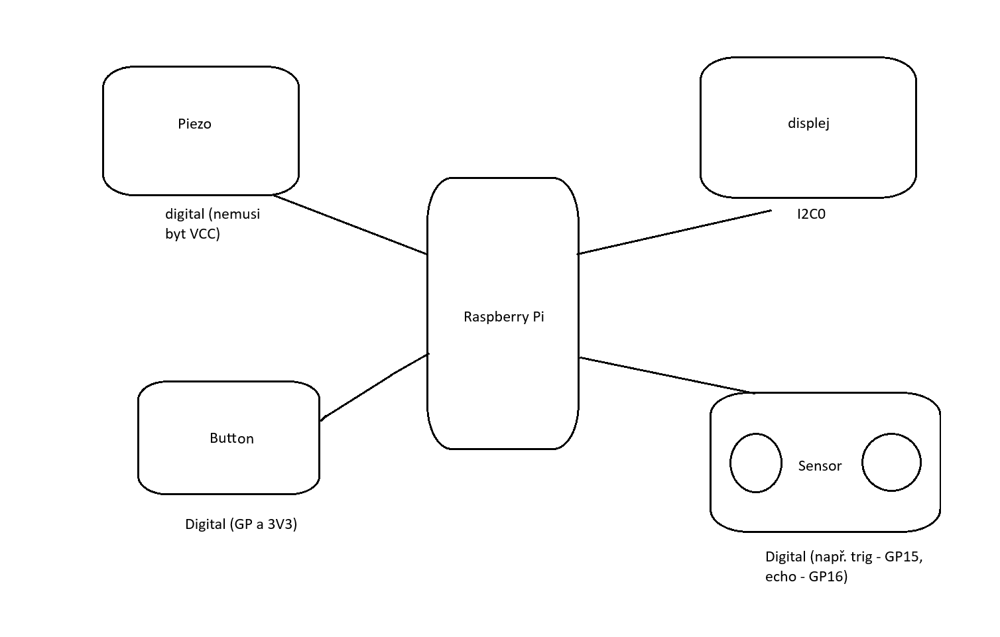

# Ultrasonic-distance-instrument
Measure distance at a steady interval and show the result and a visual near/far indication.

Add a threshold alarm, 
peak/minimum tracking, 
or a simple parking-distance display. 
Check the sensor's echo voltage and use a divider or level shifter if required.

## Team members:
- David Latzka: flowchart
- Dominik Pitrun: block diagram, pinouts
- Vojtěch Smerekovský: Github editor

## Electronic components:
- Raspberry Pi Pico
- OLED display
- Ultrasonic-distance senzor
- buzzer/speaker
- tlačítko na přepínání jednotek

## Features:
- distance measure
- parking display
- v určitých metrech se zobrazí na displeji čára (jako obrubník) (threshold alarm)
- v určitých metrech to začne pípat
- přepínání jednotek vzdálenosti

### Secondary features:
- korekce měření pomocí teploměru BME 280
- progress bar car on the side

## PINS
### Ultrasonic distance sensor HC-SR04:
- VCC
- Trig
- Echo
- GND

### Buzzer HW-508 V0.2:
- S (Signal)
- VCC
- GND

### Display 128x64 SH1106 I2C OLED:
- SDA
- SCK
- VCC
- GND

## Funkce
### Sensor
- v pravidelných intervalech snímá vzdálennost
- vzdálenost zapíše do proměnné

### Display
- má rozsvícený display s čárami parking displeje
- bere proměnnou o vzdálenosti a nechá ji vypsat na displej
- upravuje vyplneni car podle vzdálenosti
- místo pro zobrazení jednotek

### Bzucak
- bere proměnnou o vzdálenosti a podle toho pípá 
- upravuje rychlost pípání podle vzdálenosti

### Button
- zmáčknutí tlačítka se přepnou jednotky (metry/palce), toto se nahraje i na displej

## Work plan
### Week 1
- block diagram with pinouts (Dominik)
- parking display (Vojtech)
- drivers (Vojtech)
- flowchart (David)
- discord skupina (Vojtech)

### Week 2
- code for display (Vojta)
- code for measure distance (David)
- buzzer ()

