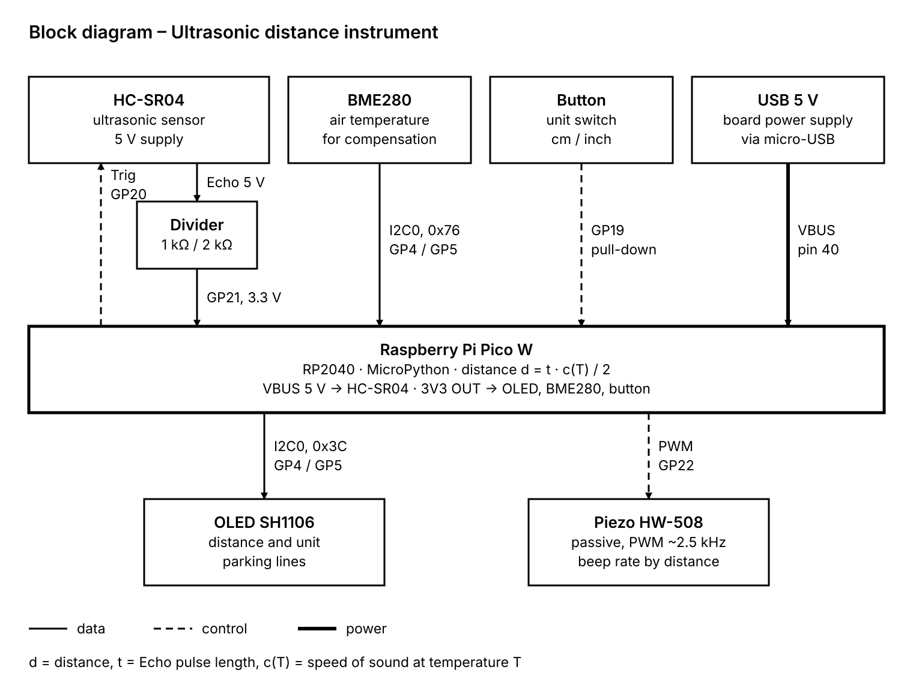
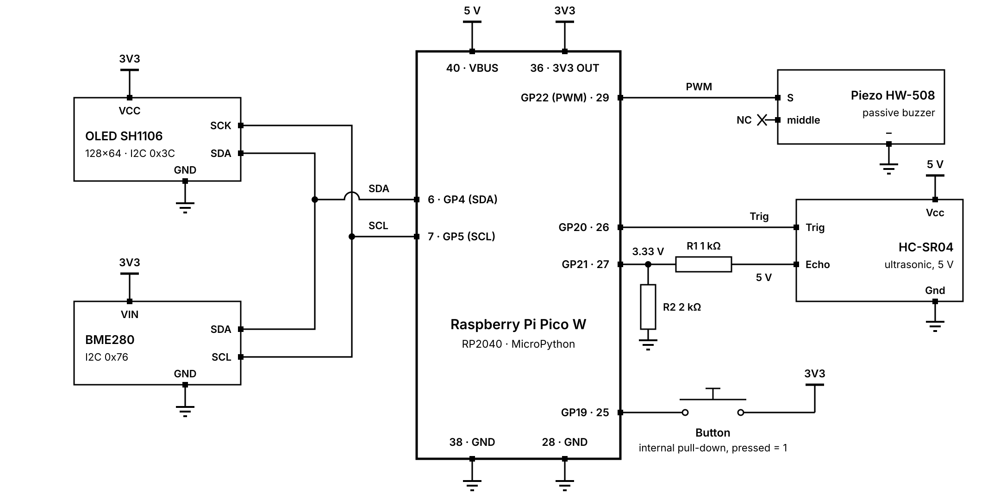
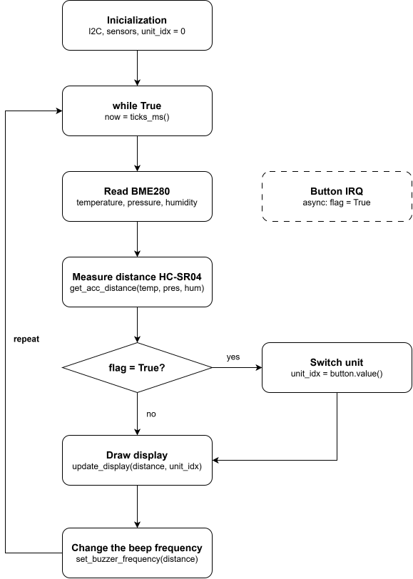
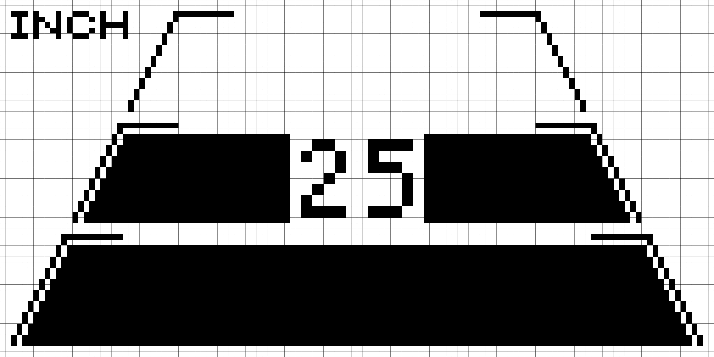

# Ultrasonic-distance-instrument
A MicroPython-based parking distance assistant built on the Raspberry Pi Pico W. The device continuously measures the distance to an obstacle using an HC-SR04 ultrasonic sensor with speed-of-sound compensation from a BME280 environmental sensor. 

The measured value is shown on an SH1106 OLED screen styled like a reversing camera (displaying the numeric distance, active unit, and three progressive proximity segments), accompanied by a piezo buzzer whose beeping rate increases as the obstacle gets closer. A push button allows switching between centimeters (`cm`) and inches (`inch`).

## Table of Contents
- [Team members](#team-members)
- [Electronic components](#electronic-components)
- [Features](#features)
- [Functions](#functions)
- [Software & Repository structure](#software--repository-structure)
- [Work plan](#work-plan)
- [Hardware design](#hardware-design)
- [Flowchart](#flowchart)
- [References](#references)

## Team members:
- David Latzka
- Dominik Pitrun
- Vojtěch Smerekovský

## Electronic components
- Raspberry Pi Pico W
- OLED display (SH1106, I2C)
- Ultrasonic distance sensor (HC-SR04)
- Temperature, humidity, and pressure sensor (BME280)
- Buzzer (HW-508)
- Push button

## Features:
- distance measure
- parking display
- at certain distances, a third of the parking camera lights up
- at a certain distance, the buzzer starts to beep
- switching between units of distance

### Secondary features:
- correction of measurements using the BME 280 thermometer
- progress bar car on the side

## Functions
### Sensor – [`drivers/hcsr04.py`](drivers/hcsr04.py) & [`drivers/bme280.py`](drivers/bme280.py)
- measures the distance at regular intervals
- compensates the speed of sound using temperature/humidity from the BME280
- stores the distance in a variable

### Display – [`drivers/update_display.py`](drivers/update_display.py) & [`drivers/sh1106.py`](drivers/sh1106.py)
- shows the parking display guide lines and measured distance
- fills the proximity thirds according to the distance
- displays the active unit (`CM` or `INCH`) in the top-left corner

### Buzzer – [`drivers/buzzer.py`](drivers/buzzer.py)
- takes a variable representing the distance and beeps accordingly
- adjusts the beeping speed according to distance

### Button – [`drivers/debouncer`](drivers/debouncer)
- pressing the button switches the displayed units (`cm` or `inch`)

## Software & Repository structure

The project is split into modular class-based drivers, standalone component test scripts, and a main application script:

- **[`main.py`](main.py)** – Main application integrating all modules, sensor measurements, display updates, buzzer control, and unit switching.

### Drivers & Classes ([`drivers/`](drivers/))
Refactored object-oriented modules and hardware libraries used by `main.py`:
- [`drivers/hcsr04.py`](drivers/hcsr04.py) – Ultrasonic distance sensor class (`HCSR04Measure`) with temperature/humidity compensation.
- [`drivers/update_display.py`](drivers/update_display.py) – Parking display interface class (drawing guide lines, filled thirds, value, and unit icons).
- [`drivers/sh1106.py`](drivers/sh1106.py) – Low-level I2C driver for the SH1106 OLED display.
- [`drivers/buzzer.py`](drivers/buzzer.py) – Piezo buzzer control class (PWM beeping intervals based on distance).
- [`drivers/bme280.py`](drivers/bme280.py) – Driver for the BME280 temperature, humidity, and pressure sensor.
- [`drivers/gpio_devices.py`](drivers/gpio_devices.py) – Helper module for GPIO peripherals.
- [`drivers/debouncer`](drivers/debouncer) – Button debouncing module.

### Standalone Component Tests ([`codes/`](codes/))
Individual test scripts created during development to verify each component separately:
- [`codes/hcsr04-test.py`](codes/hcsr04-test.py) – Ultrasonic sensor test script.
- [`codes/update_display.py`](codes/update_display.py) / [`codes/sh1106-test.py`](codes/sh1106-test.py) – OLED display and graphics test scripts.
- [`codes/buzzer-test.py`](codes/buzzer-test.py) – Piezo buzzer test script.
- [`codes/main-test.py`](codes/main-test.py) – Integration test script.

## Work plan
### Week 1
- block diagram with pinouts (Dominik)
- parking display (Vojtech)
- drivers (Vojtech)
- flowchart (David)

### Week 2
- code for display (Vojta)
- code for measure distance (David)
- code for buzzer (Dominik)
- rewrite and translate the readme (Vojta)

### Week 3
- remake codes into classes (all)
- translate to english (Hardware design and minor things)
- legend for different lines in Block scheme (Dominik)
- timing in Flowchart (David)
- links in README (Vojta)

## Hardware design

### Block scheme

Pico W sends a trigger pulse (Trig) to HC-SR04 at regular intervals and measures the response length (Echo). From the pulse length and temperature from BME280 it calculates the distance. It displays the result on the OLED display as a number and parking lines and changes the beeping speed of the piezo buzzer according to the distance. The button switches the units meters / inches.

Calculation: speed of sound `c = 331.3 + 0.606 T` (m/s, T in °C), distance `d = t · c / 2` (t = length of the Echo pulse).

### Wiring diagram

The Echo output has a level of 5 V, but the Pico Micro-controller GPIO can withstand a maximum of 3.3 V. Therefore, there is a resistor divider on a solderless field between Echo and GP21:

- R1 = 1 kΩ between Echo and GP21
- R2 = 2 kΩ between GP21 and GND

`U(GP21) = 5 V · 2 kΩ / (1 kΩ + 2 kΩ) = 3.33 V`

- The board is powered via micro-USB.
- HC-SR04 needs 5V, it takes it from VBUS (pin 40). VBUS has 5V only when powered from USB.
- OLED, BME280 and button are powered from 3V3 OUT (pin 36).
- All GNDs are common.

### Pin connections

| Module | Module Pin | Pico W | Phys. Pin | Direction | Expansion Board |
|---|---|---|---|---|---|
| OLED SH1106 | SDA | GP4 (I2C0 SDA) | 6 | bidirectional | I2C0 header, D/4 |
| OLED SH1106 | SCK | GP5 (I2C0 SCL) | 7 | Pico → OLED | I2C0 header, C/5 |
| OLED SH1106 | VCC | 3V3 OUT | 36 | power | I2C0 header, 3V3 |
| OLED SH1106 | GND | GND | 38 | ground | I2C0 header, GND |
| BME280 | SDA | GP4 (I2C0 SDA) | 6 | bidirectional | I2C0 header, D/4 |
| BME280 | SCL | GP5 (I2C0 SCL) | 7 | Pico → BME280 | I2C0 header, C/5 |
| BME280 | VIN | 3V3 OUT | 36 | power | I2C0 header, 3V3 |
| BME280 | GND | GND | 38 | ground | I2C0 header, GND |
| HC-SR04 | Trig | GP20 | 26 | Pico → sensor | Digital, GP20 row |
| HC-SR04 | Echo | GP21 (via voltage divider) | 27 | sensor → Pico | Digital, GP21 row |
| HC-SR04 | Vcc | VBUS (5 V) | 40 | power | header next to Pico, VBUS |
| HC-SR04 | Gnd | GND | 28 | ground | Digital, GND |
| Piezo HW-508 | S | GP22 (PWM) | 29 | Pico → piezo | Digital, GP22 row |
| Piezo HW-508 | – | GND | 28 | ground | Digital, GP22 row |
| Piezo HW-508 | middle | not connected (NC) | – | – | – |
| Button | pin 1 | GP19 (pull-down) | 25 | button → Pico | Digital, GP19 row |
| Button | pin 2 | 3V3 OUT | 36 | power | Digital, GP19 row |

## Flowchart

## Oled display

## References
todo
<!--
- [Raspberry Pi Pico W Documentation](https://www.raspberrypi.com/documentation/microcontrollers/pico-series.html)
- [MicroPython Documentation](https://docs.micropython.org/en/latest/)
- [HC-SR04 Ultrasonic Sensor Datasheet](https://cdn.sparkfun.com/datasheets/Sensors/Proximity/HCSR04.pdf)
- [BME280 Environmental Sensor Datasheet](https://www.bosch-sensortec.com/media/boschsensortec/downloads/datasheets/bst-bme280-ds002.pdf)
- [SH1106 OLED Driver Datasheet](https://www.velleman.eu/downloads/29/infosheets/sh1106_datasheet.pdf)
-->
