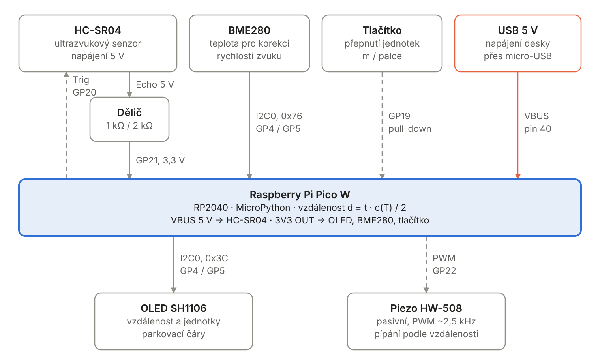
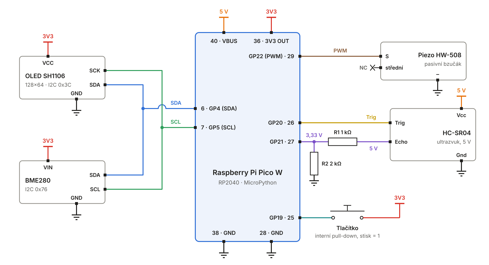
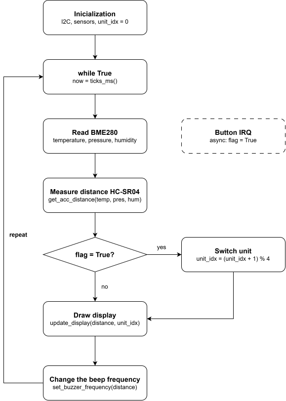
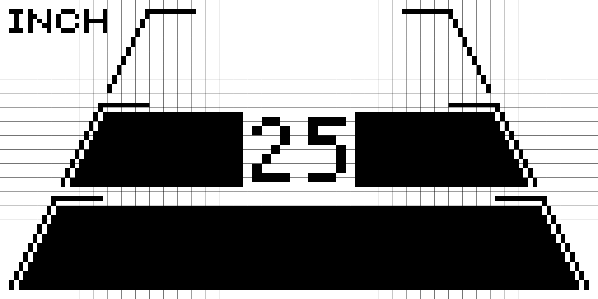

# Ultrasonic-distance-instrument
Measure distance at a steady interval and show the result and a visual near/far indication.

Add a threshold alarm, 
peak/minimum tracking, 
or a simple parking-distance display. 
Check the sensor's echo voltage and use a divider or level shifter if required.

## Team members:
- David Latzka: flowchart
- Dominik Pitrun: block diagram, pinouts
- Vojtěch Smerekovský: Github editor

## Electronic components:
- Raspberry Pi Pico
- OLED display
- Ultrasonic-distance senzor
- buzzer/speaker
- tlačítko na přepínání jednotek

## Features:
- distance measure
- parking display
- v určitých metrech se zobrazí na displeji čára (jako obrubník) (threshold alarm)
- v určitých metrech to začne pípat
- přepínání jednotek vzdálenosti

### Secondary features:
- korekce měření pomocí teploměru BME 280
- progress bar car on the side

## Funkce
### Sensor
- v pravidelných intervalech snímá vzdálennost
- vzdálenost zapíše do proměnné

### Display
- má rozsvícený display s čárami parking displeje
- bere proměnnou o vzdálenosti a nechá ji vypsat na displej
- upravuje vyplneni car podle vzdálenosti
- místo pro zobrazení jednotek

### Bzucak
- bere proměnnou o vzdálenosti a podle toho pípá 
- upravuje rychlost pípání podle vzdálenosti

### Button
- zmáčknutí tlačítka se přepnou jednotky (metry/palce), toto se nahraje i na displej

## Work plan
### Week 1
- block diagram with pinouts (Dominik)
- parking display (Vojtech)
- drivers (Vojtech)
- flowchart (David)
- discord skupina (Vojtech)

### Week 2
- code for display (Vojta)
- code for measure distance (David)
- buzzer ()

## Hardware design

### Block scheme

Pico W sends a trigger pulse (Trig) to HC-SR04 at regular intervals and measures the response length (Echo). From the pulse length and temperature from BME280 it calculates the distance. It displays the result on the OLED display as a number and parking lines and changes the beeping speed of the piezo buzzer according to the distance. The button switches the units meters / inches.

Calculation: speed of sound `c = 331.3 + 0.606 T` (m/s, T in °C), distance `d = t · c / 2` (t = length of the Echo pulse).

### Wiring diagram

The Echo output has a level of 5 V, but the Pico Micro-controller GPIO can withstand a maximum of 3.3 V. Therefore, there is a resistor divider on a solderless field between Echo and GP21:

- R1 = 1 kΩ between Echo and GP21
- R2 = 2 kΩ between GP21 and GND

`U(GP21) = 5 V · 2 kΩ / (1 kΩ + 2 kΩ) = 3.33 V`

- The board is powered via micro-USB.
- HC-SR04 needs 5V, it takes it from VBUS (pin 40). VBUS has 5V only when powered from USB.
- OLED, BME280 and button are powered from 3V3 OUT (pin 36).
- All GNDs are common.

### Zapojení pinů

| Modul | Pin modulu | Pico W | Fyz. pin | Směr | Rozšiřující deska |
|---|---|---|---|---|---|
| OLED SH1106 | SDA | GP4 (I2C0 SDA) | 6 | obousměrně | lišta I2C0, D/4 |
| OLED SH1106 | SCK | GP5 (I2C0 SCL) | 7 | Pico → OLED | lišta I2C0, C/5 |
| OLED SH1106 | VCC | 3V3 OUT | 36 | napájení | lišta I2C0, 3V3 |
| OLED SH1106 | GND | GND | 38 | zem | lišta I2C0, GND |
| BME280 | SDA | GP4 (I2C0 SDA) | 6 | obousměrně | lišta I2C0, D/4 |
| BME280 | SCL | GP5 (I2C0 SCL) | 7 | Pico → BME280 | lišta I2C0, C/5 |
| BME280 | VIN | 3V3 OUT | 36 | napájení | lišta I2C0, 3V3 |
| BME280 | GND | GND | 38 | zem | lišta I2C0, GND |
| HC-SR04 | Trig | GP20 | 26 | Pico → senzor | Digital, řádek GP20 |
| HC-SR04 | Echo | GP21 (přes dělič) | 27 | senzor → Pico | Digital, řádek GP21 |
| HC-SR04 | Vcc | VBUS (5 V) | 40 | napájení | lišta vedle Pica, VBUS |
| HC-SR04 | Gnd | GND | 28 | zem | Digital, GND |
| Piezo HW-508 | S | GP22 (PWM) | 29 | Pico → piezo | Digital, řádek GP22 |
| Piezo HW-508 | – | GND | 28 | zem | Digital, řádek GP22 |
| Piezo HW-508 | prostřední | nezapojen (NC) | – | – | – |
| Tlačítko | vývod 1 | GP19 (pull-down) | 25 | tlačítko → Pico | Digital, řádek GP19 |
| Tlačítko | vývod 2 | 3V3 OUT | 36 | napájení | Digital, řádek GP19 |

## Flowchart

## Oled display

