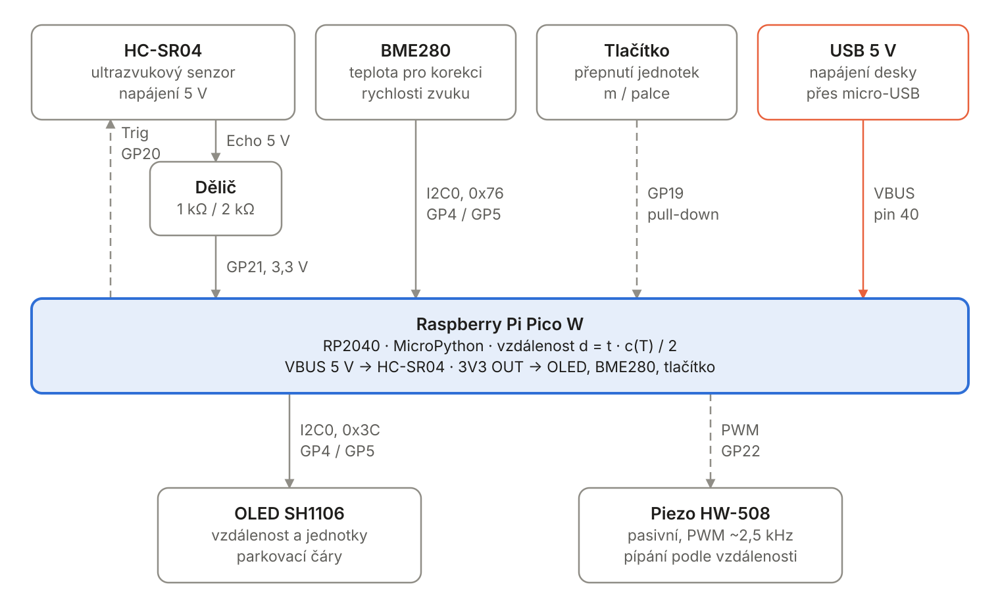
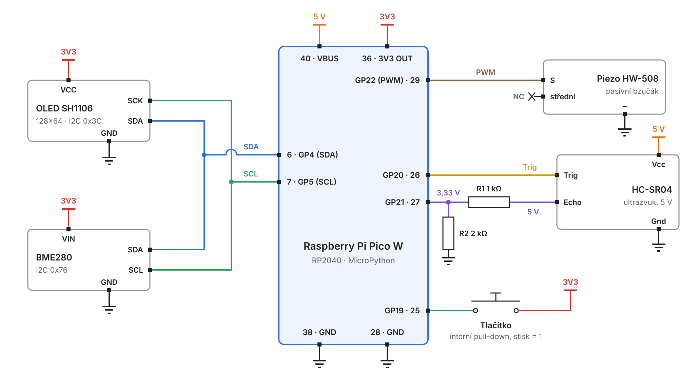

# Ultrasonic-distance-instrument
Measure distance at a steady interval and show the result and a visual near/far indication.

Add a threshold alarm, 
peak/minimum tracking, 
or a simple parking-distance display. 
Check the sensor's echo voltage and use a divider or level shifter if required.

## Team members:
- David Latzka
- Dominik Pitrun
- Vojtěch Smerekovský

## Electronic components:
- Raspberry Pi Pico
- OLED display
- Ultrasonic-distance senzor
- temperature, humidity and air pressure meter
- buzzer/speaker
- button

## Features:
- distance measure
- parking display
- at certain distances, a third of the parking camera lights up
- at a certain distance, the buzzer starts to beep
- switching between units of distance

### Secondary features:
- correction of measurements using the BME 280 thermometer
- progress bar car on the side

## Funkce
### Sensor
- measures the distance at regular intervals
- stores the distance in a variable

### Display
- its display is lit up and shows the parking display lines
- takes a variable representing a distance and displays it on the screen
- adjusts the filling of lines according to distance
- the unit of distance (cm or inch) is shown in the top left-hand corner

### Bzucak
- takes a variable representing the distance and beeps accordingly
- adjusts the beeping speed according to distance

### Button
- pressing the button switches the units (cm or inch)

## Work plan
### Week 1
- block diagram with pinouts (Dominik)
- parking display (Vojtech)
- drivers (Vojtech)
- flowchart (David)

### Week 2
- code for display (Vojta)
- code for measure distance (David)
- code for buzzer (Dominik)
- rewrite and translate the readme (Vojta)

## Hardware design

### Block scheme

Pico W sends a trigger pulse (Trig) to HC-SR04 at regular intervals and measures the response length (Echo). From the pulse length and temperature from BME280 it calculates the distance. It displays the result on the OLED display as a number and parking lines and changes the beeping speed of the piezo buzzer according to the distance. The button switches the units meters / inches.

Calculation: speed of sound `c = 331.3 + 0.606 T` (m/s, T in °C), distance `d = t · c / 2` (t = length of the Echo pulse).

### Wiring diagram

The Echo output has a level of 5 V, but the Pico Micro-controller GPIO can withstand a maximum of 3.3 V. Therefore, there is a resistor divider on a solderless field between Echo and GP21:

- R1 = 1 kΩ between Echo and GP21
- R2 = 2 kΩ between GP21 and GND

`U(GP21) = 5 V · 2 kΩ / (1 kΩ + 2 kΩ) = 3.33 V`

- The board is powered via micro-USB.
- HC-SR04 needs 5V, it takes it from VBUS (pin 40). VBUS has 5V only when powered from USB.
- OLED, BME280 and button are powered from 3V3 OUT (pin 36).
- All GNDs are common.

### Zapojení pinů

| Modul | Pin modulu | Pico W | Fyz. pin | Směr | Rozšiřující deska |
|---|---|---|---|---|---|
| OLED SH1106 | SDA | GP4 (I2C0 SDA) | 6 | obousměrně | lišta I2C0, D/4 |
| OLED SH1106 | SCK | GP5 (I2C0 SCL) | 7 | Pico → OLED | lišta I2C0, C/5 |
| OLED SH1106 | VCC | 3V3 OUT | 36 | napájení | lišta I2C0, 3V3 |
| OLED SH1106 | GND | GND | 38 | zem | lišta I2C0, GND |
| BME280 | SDA | GP4 (I2C0 SDA) | 6 | obousměrně | lišta I2C0, D/4 |
| BME280 | SCL | GP5 (I2C0 SCL) | 7 | Pico → BME280 | lišta I2C0, C/5 |
| BME280 | VIN | 3V3 OUT | 36 | napájení | lišta I2C0, 3V3 |
| BME280 | GND | GND | 38 | zem | lišta I2C0, GND |
| HC-SR04 | Trig | GP20 | 26 | Pico → senzor | Digital, řádek GP20 |
| HC-SR04 | Echo | GP21 (přes dělič) | 27 | senzor → Pico | Digital, řádek GP21 |
| HC-SR04 | Vcc | VBUS (5 V) | 40 | napájení | lišta vedle Pica, VBUS |
| HC-SR04 | Gnd | GND | 28 | zem | Digital, GND |
| Piezo HW-508 | S | GP22 (PWM) | 29 | Pico → piezo | Digital, řádek GP22 |
| Piezo HW-508 | – | GND | 28 | zem | Digital, řádek GP22 |
| Piezo HW-508 | prostřední | nezapojen (NC) | – | – | – |
| Tlačítko | vývod 1 | GP19 (pull-down) | 25 | tlačítko → Pico | Digital, řádek GP19 |
| Tlačítko | vývod 2 | 3V3 OUT | 36 | napájení | Digital, řádek GP19 |

## Flowchart

## Oled display

